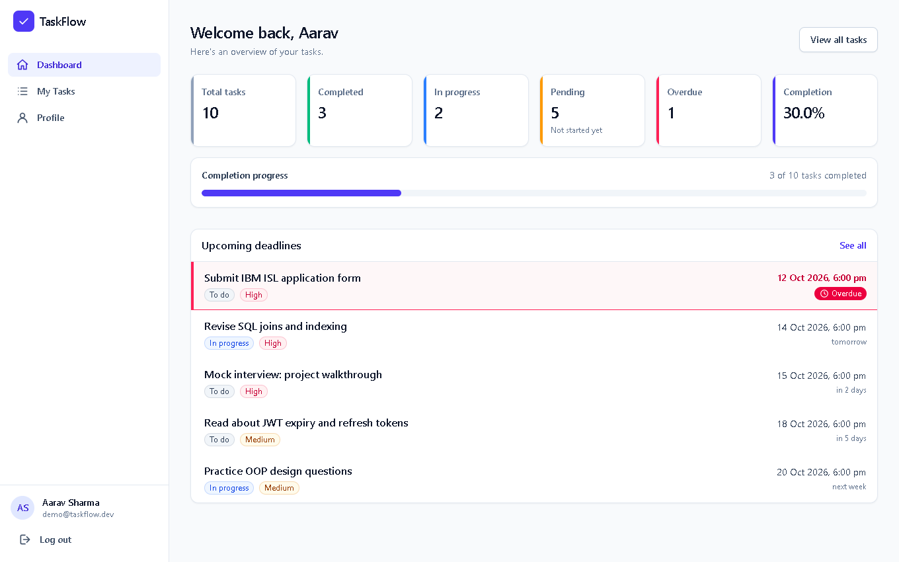
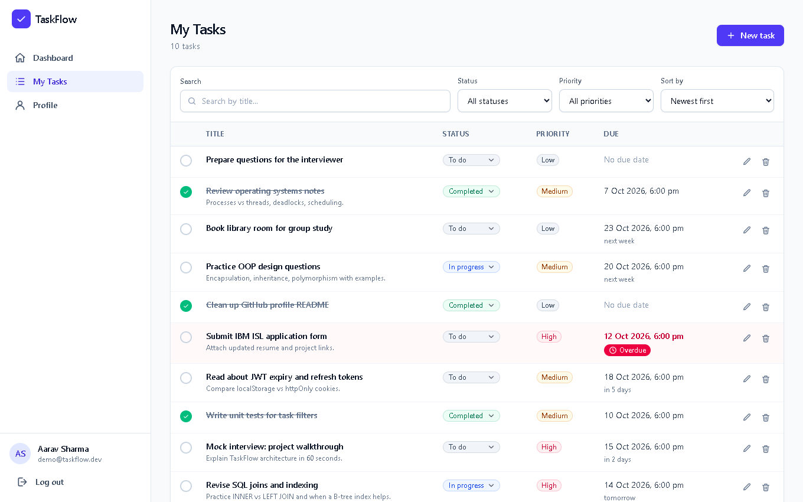
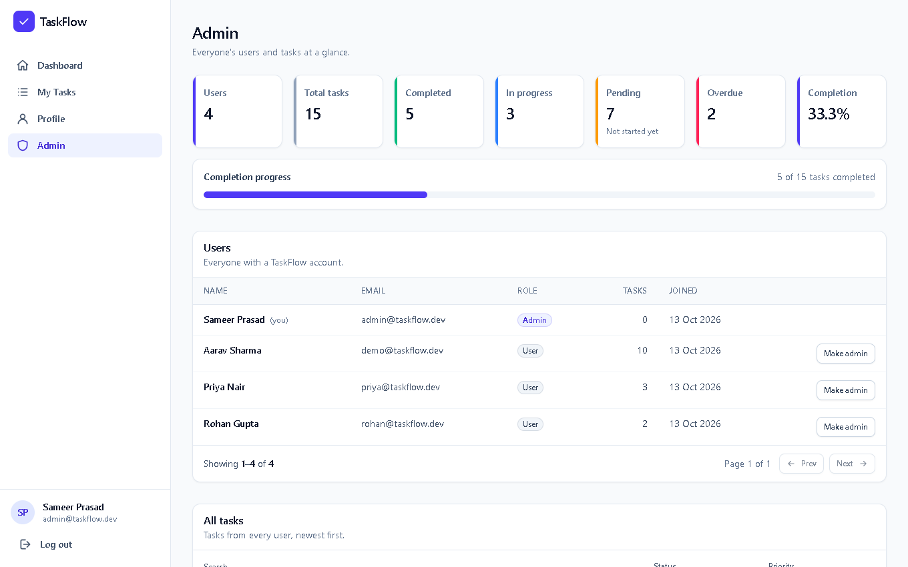
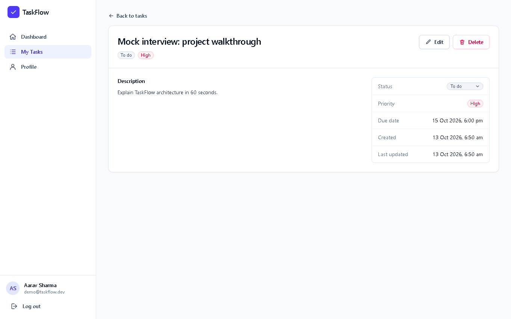
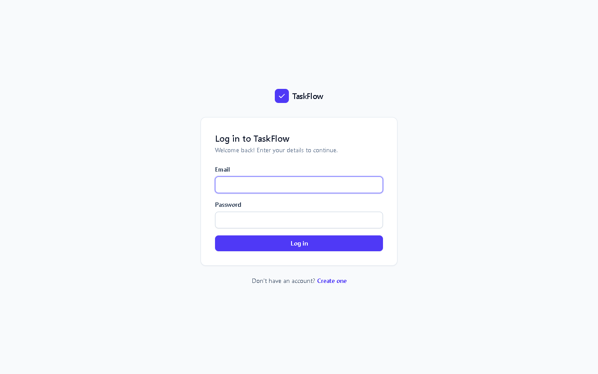
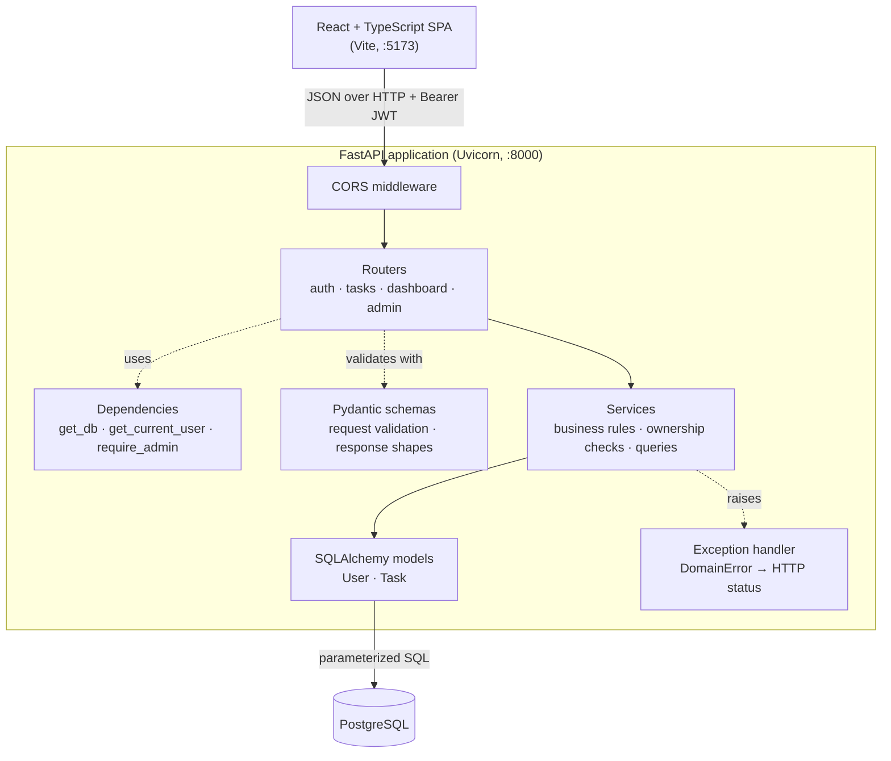
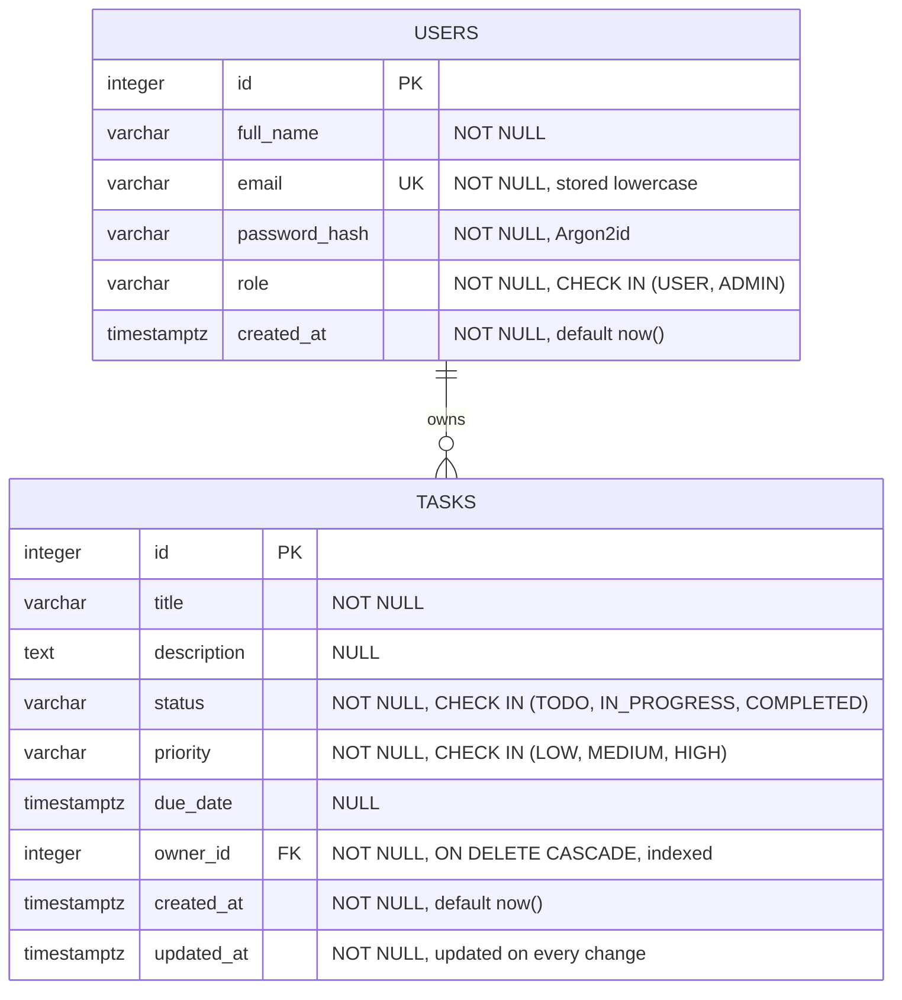

# TaskFlow

A full-stack task management application with JWT authentication, role-based access control, and a PostgreSQL-backed REST API.

[](https://github.com/Stark2028/taskflow/actions/workflows/ci.yml)




## Features

- **Accounts**: registration, login, profile and password updates. Passwords are hashed with Argon2id; emails are unique and case-insensitive.
- **JWT authentication**: stateless bearer tokens with expiry; every protected request is verified on the server.
- **Role-based authorization**: `USER`s can only see and change their own tasks; `ADMIN`s can view all users and tasks, manage any task, and change user roles. Public registration can never create an admin; the first admin is created with a CLI script.
- **Task management**: create, view, update (PUT), change status (PATCH), and delete tasks with title, description, status, priority, and due date.
- **Search, filter, sort, paginate**: filter by status and priority, case-insensitive title search, sort by created date / due date / priority, `limit`/`offset` pagination with validated bounds.
- **Dashboard**: total, completed, in-progress, pending, and overdue counts plus completion rate, computed in a single SQL aggregate query.
- **Admin panel**: system-wide statistics, users with their task counts (`LEFT JOIN` + `GROUP BY`), and every task with its owner.
- **Tested**: 53 pytest tests run against an isolated PostgreSQL database, plus GitHub Actions CI that applies migrations to a fresh database, checks for schema drift, runs the tests, and lints/builds the frontend.

## Screenshots

| Tasks | Admin |
| --- | --- |
|  |  |
| **Task details** | **Login** |
|  |  |

## Tech stack

| Layer | Technology |
| --- | --- |
| Backend | Python 3.12, FastAPI, Pydantic v2, SQLAlchemy 2.1 (ORM), Alembic (migrations), Uvicorn |
| Database | PostgreSQL 18 (psycopg 3 driver) |
| Auth | PyJWT (HS256 access tokens), argon2-cffi (Argon2id password hashing) |
| Frontend | React 19, TypeScript, Vite, Tailwind CSS v4, React Router 7, Axios, Oxlint |
| Testing | pytest, FastAPI `TestClient` (HTTPX), dedicated PostgreSQL test database |
| CI | GitHub Actions |

## Architecture



| Layer | Responsibility | Never does |
| --- | --- | --- |
| `routers/` | HTTP: paths, status codes, request/response models | Business rules or SQL |
| `dependencies.py` | Per-request database session, current user from JWT, admin guard | Endpoint logic |
| `schemas/` | Validate input (types, lengths, enums, timezone-aware dates) and shape output | Database access |
| `services/` | Business rules, ownership checks, queries, transactions | Know about HTTP |
| `models/` | Table definitions, constraints, relationships | Validation of API input |
| `core/` | Settings, password hashing, JWT, domain exceptions | — |

Services raise domain exceptions (`NotFoundError`, `ConflictError`, `PermissionDeniedError`, ...). A single exception handler in `main.py` maps them to `404`, `409`, `403`, etc., which keeps business logic independent of HTTP.

## Database design



- **Integrity in the database, not just the app**: primary keys, `UNIQUE(email)`, `NOT NULL`, `CHECK` constraints for enum values, and a foreign key with `ON DELETE CASCADE`. Even a buggy client or a manual SQL statement cannot store an invalid status or an orphaned task.
- **Indexes**: `users.email` (via the unique constraint) for login lookups, and `tasks.owner_id`, because PostgreSQL does not index foreign keys automatically and almost every query filters by owner.
- **Enums as `VARCHAR` + `CHECK`** instead of native PostgreSQL enum types, so adding a value later is a simple migration.
- **`timestamptz`** everywhere: times are stored as UTC instants; a task is overdue when `due_date < now()` and it is not completed.
- **Migrations** are managed with Alembic (`backend/alembic/versions/`), and CI fails if the models and migrations drift apart (`alembic check`).

## API reference

Interactive documentation (Swagger UI) is served at **<http://localhost:8000/docs>** while the backend is running. Click **Authorize** and paste an access token from `/api/auth/login` to try protected endpoints.

| Method | Endpoint | Access | Description |
| --- | --- | --- | --- |
| `GET` | `/api/health` | Public | API and database health check |
| `POST` | `/api/auth/register` | Public | Create a `USER` account → `201` (`409` if email exists) |
| `POST` | `/api/auth/login` | Public | Exchange email + password for a JWT (`401` on bad credentials) |
| `GET` | `/api/auth/me` | User | Current user's profile |
| `PATCH` | `/api/auth/me` | User | Update name and/or password (requires current password) |
| `POST` | `/api/tasks` | User | Create a task → `201` |
| `GET` | `/api/tasks` | User | Own tasks: `status`, `priority`, `search`, `sort_by`, `order`, `limit`, `offset` |
| `GET` | `/api/tasks/{id}` | Owner / Admin | Task details (`404` if missing or not yours) |
| `PUT` | `/api/tasks/{id}` | Owner / Admin | Replace all editable fields |
| `PATCH` | `/api/tasks/{id}/status` | Owner / Admin | Change only the status |
| `DELETE` | `/api/tasks/{id}` | Owner / Admin | Delete a task → `204` |
| `GET` | `/api/dashboard/summary` | User | Own task statistics |
| `GET` | `/api/admin/summary` | Admin | System-wide statistics and user count |
| `GET` | `/api/admin/users` | Admin | Users with task counts (paginated) |
| `PATCH` | `/api/admin/users/{id}/role` | Admin | Promote/demote a user (not yourself) |
| `GET` | `/api/admin/tasks` | Admin | All tasks with owner details; same filters plus `owner_id` |

Errors use one shape: `{"detail": "message"}` (validation errors return FastAPI's `422` list format). Status codes used: `200`, `201`, `204`, `400`, `401`, `403`, `404`, `409`, `422`, `503`.

## Getting started

### Prerequisites

- Python 3.12+
- Node.js 20+ and npm
- PostgreSQL 16+ (developed on 18)
- Git

### 1. Clone

```bash
git clone https://github.com/Stark2028/taskflow.git
cd taskflow
```

### 2. Create the databases

Open `psql` as the `postgres` superuser (on Windows: `& "C:\Program Files\PostgreSQL\18\bin\psql.exe" -U postgres -h localhost`) and run:

```sql
CREATE ROLE taskflow_user WITH LOGIN PASSWORD 'choose-a-password';
CREATE DATABASE taskflow OWNER taskflow_user;
CREATE DATABASE taskflow_test OWNER taskflow_user;  -- used only by the test suite
```

### 3. Backend

```bash
cd backend
python -m venv .venv
.venv\Scripts\activate          # Windows PowerShell: .\.venv\Scripts\Activate.ps1
# source .venv/bin/activate     # macOS / Linux
pip install -r requirements.txt

cp .env.example .env            # Windows: copy .env.example .env
# Edit .env: set the database password in DATABASE_URL / TEST_DATABASE_URL
# and generate JWT_SECRET_KEY with:
python -c "import secrets; print(secrets.token_urlsafe(48))"

alembic upgrade head                                            # create the tables
python -m scripts.create_admin --email you@example.com --name "Your Name"   # first admin (prompts for a password)
python -m scripts.seed_demo                                     # optional demo users and tasks
uvicorn app.main:app --reload
```

The API is now on <http://localhost:8000> and the docs on <http://localhost:8000/docs>.

### 4. Frontend

```bash
cd frontend
npm install
cp .env.example .env            # VITE_API_URL=http://localhost:8000
npm run dev
```

Open <http://localhost:5173>. With demo data loaded you can sign in as `demo@taskflow.dev` / `DemoPass123` (local development only).

## Running tests

```bash
cd backend
pytest -v
```

The suite (53 tests) covers registration (including duplicate emails and attempts to self-assign `ADMIN`), login failures, missing/expired/forged tokens, task CRUD, validation errors, cross-user access attempts, filtering, search (including `%` wildcard escaping), sorting, pagination bounds, dashboard counts, and admin authorization.

Tests never touch the development database: `tests/conftest.py` builds the schema in `taskflow_test`, overrides the app's `get_db` dependency to use it, and truncates every table after each test. It refuses to run if the test and development database names are the same.

## Project structure

```text
taskflow/
├── backend/
│   ├── app/
│   │   ├── main.py              # app setup: CORS, exception handler, routers, health check
│   │   ├── dependencies.py      # DB session, current user (JWT), admin guard
│   │   ├── core/                # settings, security (Argon2, JWT), domain exceptions
│   │   ├── database/            # engine/session factory, declarative base
│   │   ├── models/              # SQLAlchemy models: User, Task
│   │   ├── schemas/             # Pydantic request/response models
│   │   ├── services/            # business logic: auth, tasks, users
│   │   └── routers/             # HTTP endpoints: auth, tasks, dashboard, admin
│   ├── alembic/                 # database migrations
│   ├── scripts/                 # create_admin, seed_demo
│   ├── tests/                   # pytest suite
│   ├── requirements.txt
│   └── .env.example
├── frontend/
│   ├── src/
│   │   ├── api/                 # Axios client (auth interceptors) + one module per API area
│   │   ├── context/             # AuthProvider and useAuth hook (token, current user)
│   │   ├── components/          # layout, sidebar, badges, modal, task form/list, route guards
│   │   ├── hooks/               # data fetching, debounced search, Escape-to-close
│   │   ├── pages/               # one component per route
│   │   └── utils/               # date formatting, labels, validation
│   └── .env.example
├── docs/screenshots/
└── .github/workflows/ci.yml
```

## Security notes and trade-offs

- **Token storage**: the frontend keeps the JWT in `localStorage`. This is simple and works across tabs, but any successful XSS attack could read it. An `httpOnly` cookie would hide the token from JavaScript but requires CSRF protection. React's default output escaping reduces XSS risk; it does not eliminate it.
- **Logout** is client-side: the token is discarded. Because JWTs are stateless, a stolen token stays valid until it expires (60 minutes by default). Revocation would need a token denylist or short-lived access tokens with refresh tokens.
- **Authorization is enforced by the backend.** Hidden buttons and route guards in the UI are only for usability. Other users' tasks return `404` rather than `403`, so task IDs belonging to others cannot be discovered.
- **Login responses** are identical for unknown emails and wrong passwords, and an unknown email still performs a dummy Argon2 check, so timing does not reveal which emails are registered.
- **SQL injection**: all queries go through the SQLAlchemy ORM with bound parameters; search input has `%` and `_` escaped.
- **Secrets** come from environment variables; `.env` is git-ignored and only `.env.example` is committed. CORS is restricted to the configured frontend origins.
- This is a learning project. These controls are a reasonable baseline, not a production security review: there is no rate limiting, account lockout, HTTPS termination, or audit logging.

## Future improvements

- Refresh tokens with rotation, or `httpOnly` cookie sessions with CSRF protection
- Rate limiting on login and registration
- Optimistic locking (a `version` column) so concurrent edits cannot silently overwrite each other
- Composite indexes such as `(owner_id, status)` once real query plans show a need
- Task categories/tags and sharing tasks between users
- Docker Compose for one-command local setup, and a cloud deployment
- Frontend unit and end-to-end tests
